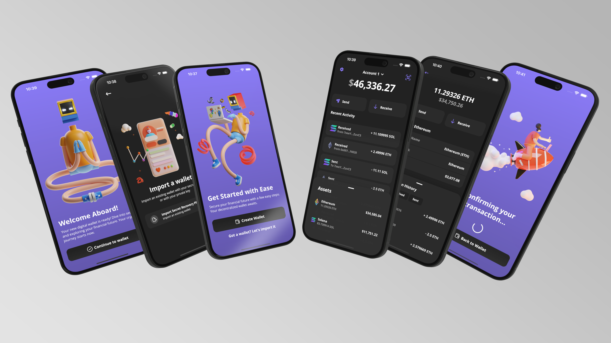

<div align="center">
  
  
  <h1>Expo App that crashes on launch (Redxam Wallet)</h1>
</div>

A mobile crypto wallet built with React Native and Expo. It lets you create or import a wallet and send, receive and track test coins on Ethereum (Sepolia testnet) and Solana (Devnet). The repository name says the app crashed on launch at some point, see the status section below.

## Status

Prototype, testnet only, and needs your own Alchemy API keys. This repository is a copy of the open source project [vinnyhoward/rn-crypto-wallet](https://github.com/vinnyhoward/rn-crypto-wallet) by Vince Howard (MIT license, see `LICENSE.txt`), set up under the app name "Redxam Wallet". The app has not been verified to launch in this copy. If it closes right after opening, check the troubleshooting list in the setup section.

It is a native app, so it cannot be hosted as a static web demo. Do not use it with real funds.

## About

Redxam Wallet is a multi-chain cryptocurrency wallet built with React Native. It manages digital assets on Ethereum and Solana.

### Key Features:
- **Multi-Chain Support**: Seamlessly manage Ethereum and Solana assets within a single, user-friendly interface.
- **Wallet Management**: Create new wallets, import existing ones, and manage multiple accounts with ease.
- **Transaction Handling**: Send, receive, and track transactions across supported blockchains.
- **Balance and Portfolio Tracking**: View real-time balances and monitor your overall crypto portfolio.
- **Security**: Implements encryption and secure storage techniques to protect your digital assets.
- **QR Code Integration**: Simplify address sharing and transaction processes with built-in QR code functionality.

It uses the Expo framework for the app and the Alchemy API for blockchain access.

### Testnet-Only Application
**Important**: The wallet is designed for use with the Ethereum Sepolia testnet and Solana Devnet only. It is not intended for use with real cryptocurrencies or on mainnet networks. This testnet focus allows for safe experimentation and development without risking actual digital assets.

#### Testnet Resources:
- **Ethereum (Sepolia Testnet)**: Obtain free test ETH from the [Sepolia Faucet](https://www.infura.io/faucet/sepolia).
- **Solana (Devnet)**: Acquire free test SOL from the [Solana Devnet Faucet](https://faucet.solana.com/).

### Development Focus
The project serves as both a functional crypto wallet and a showcase of modern mobile development practices. It demonstrates the integration of blockchain technologies with React Native, emphasizing clean code architecture, robust state management with Redux, and a strong focus on security.


## Tech Stack

This project leverages a modern tech stack for building and managing a cross-platform cryptocurrency wallet application:

* [![typescript][typescript]][ts-url] - A strongly typed programming language that builds on JavaScript, giving you better tooling at any scale.

* [![react-native][react-native]][rn-url] - A framework for building native apps using React, enabling native mobile development with JavaScript.

* [![expo][expo]][expo-url] - An open-source platform for making universal native apps with React that run on Android, iOS, and the web.

* [![redux][redux]][redux-url] - A predictable state container for JavaScript apps, used for managing state in the mobile app.

* [![styled-components][styled-components]][sc-url] - A library that utilizes tagged template literals to style your components at a component level using CSS.

* **Ethers.js** - A complete Ethereum wallet implementation and utilities in JavaScript (and TypeScript), used for blockchain interactions.

* **@solana/web3.js** - Solana’s JavaScript API library, enabling interaction with the Solana Blockchain.

* **Alchemy SDK** - A powerful toolkit that simplifies the process of making requests to the Blockchain, enhancing the app’s capability to interact with Ethereum and Solana.


---

## Features

### Wallet Management
- **Create Wallet**: Generate new wallets seamlessly.
- **Import Wallets**: Import existing wallets using mnemonic phrases.
- **Manage Multiple Wallets**: Create and manage multiple wallets using the same mnemonic phrase.
- **Account Management**: Rename and manage different wallet accounts.
- **Switch Wallets**: Easily switch between different wallet accounts.

| Creating a new wallet | Importing a wallet | Managing your wallet |
|:---:|:---:|:---:|
|  |  |  |


### Wallet Balance and Transactions
- **Net Worth**: View the total net worth across all wallets.
- **Balance Viewing**: Check the balance of Ethereum and Solana wallets.
- **Transaction Management**:
  - Send and receive Ethereum and Solana transactions.
  - View a list of past transactions for both Ethereum and Solana.

| Viewing wallet transactions  | Viewing Ethereum balance  | Sending Ethereum |
|:---:|:---:|:---:|
|  |  |  |

### Accessibility Features
- **QR Code Functionality**: Easily share wallet addresses and send cryptocurrencies via QR codes.

| Sharing Address  | Scanning QR code | 
|:---:|:---:|
|  |  

### Security

#### Encryption and Secure Storage
- **Advanced Encryption Standard (AES)**: Utilizes AES encryption, the gold standard in symmetric cryptography, to secure sensitive data.
- **Secure Local Storage**: Leverages React Native's `SecureStore` module, which uses Keychain Services on iOS and KeyStore on Android, providing OS-level security for stored data.

#### Cryptographic Best Practices
- **Password-Based Key Derivation Function 2 (PBKDF2)**:
  - Implements PBKDF2 for key derivation, significantly increasing resistance to brute-force attacks.
- **Salted Hashes**: Employs unique salts for each encryption operation, preventing rainbow table attacks and enhancing overall security.

#### Key Security
- **Unique Key Generation**: Implements a secure system for generating and storing unique encryption keys for each user, significantly enhancing the protection of sensitive data.
- **Advanced Key Derivation**: Utilizes key derivation functions to ensure that each user's encryption key is both strong and unique.

#### Wallet Security
- **Non-Custodial Design**: Users maintain full control of their private keys, which are never transmitted or stored unencrypted.
- **Mnemonic Phrase Protection**: Recovery phrases are encrypted before storage, ensuring they remain secure even if the device is compromised.

#### Code-Level Security Measures
- **Type Safety**: Utilizes TypeScript to prevent common programming errors and enhance code reliability.
- **Separation of Concerns**: Cryptographic operations are isolated in dedicated modules, facilitating code audits and reducing the risk of security vulnerabilities.
- **Error Handling**: Implements comprehensive error handling to prevent information leakage through error messages.

#### Future Security Enhancements (In Development)
- **Biometric Authentication**: Plans to integrate fingerprint and face recognition for an additional layer of security.
- **Secure Enclave Integration**: Future updates aim to leverage hardware-based key storage on supported devices for enhanced private key protection.
- **Transaction Signing**: Upcoming feature to allow offline transaction signing, further securing the transaction process.

#### Security Considerations for Users
- **Testnet Focus**: Currently designed for testnet use only. Users are advised against using real cryptocurrency with this wallet until a full security audit is completed.
- **Regular Updates**: The development team is committed to regular security updates and patch releases to address any discovered vulnerabilities promptly.


---

## Quick Start

### Prerequisites

- Node.js 18 or later
- Yarn 1.22 (the lockfile is `yarn.lock`)
- An [Alchemy](https://www.alchemy.com/) account with an Ethereum Sepolia app and a Solana Devnet app (free)
- For iOS: macOS with Xcode. For Android: Android Studio with an emulator or a phone with USB debugging
- This app uses native modules (camera, biometrics, secure store) and `expo-dev-client`, so it does not run in Expo Go. You must build a development client.

### Steps

1. Clone the repository and install dependencies:

```bash
git clone https://github.com/maxawad/Expo-App-that-crashes-on-launch.git
cd Expo-App-that-crashes-on-launch
yarn install
```

2. Create your environment file from the template and fill in your own keys:

```bash
cp .env.example .env
```

| Variable | Meaning |
|---|---|
| `EXPO_PUBLIC_ALCHEMY_ETH_KEY` | Your Alchemy API key for Ethereum Sepolia |
| `EXPO_PUBLIC_ALCHEMY_ETH_URL` | Base URL for Ethereum requests, ends with `/v2/` |
| `EXPO_PUBLIC_ALCHEMY_SOCKET_URL` | WebSocket base URL for live balance updates, ends with `/v2/` |
| `EXPO_PUBLIC_ALCHEMY_SOL_URL` | Base URL for Solana Devnet requests, ends with `/v2/` |
| `EXPO_PUBLIC_ALCHEMY_SOL_API_KEY` | Your Alchemy API key for Solana Devnet |
| `EXPO_PUBLIC_ENVIRONMENT` | `development` for testnets, `production` switches Ethereum to mainnet |

Variables starting with `EXPO_PUBLIC_` are bundled into the app, so use keys that are restricted to your own app and never reuse a key you care about.

3. Build and run a development client on a device or emulator:

```bash
yarn ios       # or: yarn android
```

4. For later sessions, start the dev server and open the installed development client:

```bash
yarn start
```

### Troubleshooting a crash on launch

- Make sure `.env` exists and every variable is filled in. The Ethereum and Solana services are created as soon as the app loads, so a missing or malformed URL or key fails at startup.
- Restart Metro with a clean cache after changing `.env`: `yarn start --clear`.
- Run the app in a development client (`yarn ios` or `yarn android`), not in Expo Go.
- Run `yarn install` again if native modules were added or upgraded, then rebuild the client.

### Tests

```bash
yarn test
```

## Roadmap 

The wallet is continuously evolving. Here is the roadmap from the original project for future developments:

### Near Term Goals

#### Bug Fixes
- [x] Account list causes too many re-renders

#### Enhanced Security
- [x] Implement confirmation screen for transactions
- [ ] Integrate biometric authentication (fingerprint and face recognition)
- [x] Remove hardcoded environment variables and use dynamic key generation so each user has their own unique key.
- [x] Implement secure key generation and storage unique to each user
  - Utilizes advanced encryption methods for key derivation
  - Ensures each user has a unique, securely stored encryption key
- [ ] Add option for 2-factor authentication (2FA)

#### User Experience Improvements
- [ ] Animations and Transitions: 
  - [x] Enhance confirmation screen
  - [ ] Create engaging splash screen
  - [x] Improve create wallet screen animations
  - [ ] Add subtle animations for balance updates and transactions
- [x] Refactor and optimize Redux structure for better performance
- [ ] Implement light mode and customizable themes

#### Feature Enhancements
- [ ] Multi-chain pagination support for transaction history
- [ ] Add profit/loss tracking UI for purchased assets
- [ ] Implement real-time price alerts and notifications

### Long Term Goals

#### Blockchain Expansion
- [ ] Integrate Polygon blockchain support
- [ ] Add support for Bitcoin (BTC) transactions
- [ ] Explore integration with layer-2 solutions (e.g., Optimism, Arbitrum)

#### Advanced Features
- [ ] Implement NFT support:
  - [ ] List NFT transactions across all supported blockchains
  - [ ] Add NFT gallery view and management features

This roadmap is a living document and will evolve based on technological advancements, user feedback, and market trends.

Your feedback and suggestions are always welcome as I continue to improve and expand the wallet!

---

## License 

Distributed under the MIT License. See `LICENSE.txt` for more information.

---

## Credits

Original project: [vinnyhoward/rn-crypto-wallet](https://github.com/vinnyhoward/rn-crypto-wallet) by Vince Howard. Released under the MIT License. A license file for the original work is in `LICENSE.txt`.

[typescript]: https://img.shields.io/badge/typescript-%23007ACC.svg?style=for-the-badge&logo=typescript&logoColor=white
[ts-url]: https://www.typescriptlang.org/
[react-native]: https://img.shields.io/badge/react_native-%2320232a.svg?style=for-the-badge&logo=react&logoColor=%2361DAFB
[rn-url]: https://reactnative.dev/
[expo]: https://img.shields.io/badge/expo-1C1E24?style=for-the-badge&logo=expo&logoColor=#D04A37
[expo-url]: https://docs.expo.dev/
[styled-components]: https://img.shields.io/badge/styled--components-DB7093?style=for-the-badge&logo=styled-components&logoColor=white
[sc-url]: https://styled-components.com/
[redux]: https://img.shields.io/badge/redux-%23593d88.svg?style=for-the-badge&logo=redux&logoColor=white
[redux-url]: https://redux.js.org/
